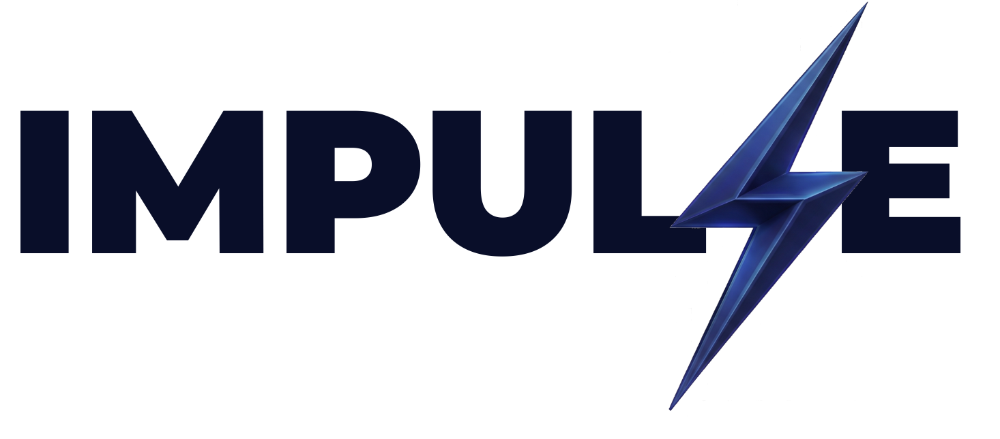

<p align="center">
  
</p>

# Impulse IT — Presença digital com foco em conversão

**Impressione. Impulsione. Venda.**

Landing page institucional da Impulse IT, desenvolvida para apresentar soluções digitais, demonstrar possibilidades de design e transformar o interesse dos visitantes em conversas comerciais pelo WhatsApp.

O projeto combina apresentação visual, navegação em página única e conteúdo comercial para aproximar empresas e empreendedores de serviços como sites institucionais, landing pages, catálogos interativos e desenvolvimento sob demanda.

## Objetivo do projeto

Criar uma vitrine digital que comunique o valor da Impulse, explique sua proposta de trabalho e facilite o primeiro contato sobre um projeto. A experiência atende tanto quem está conhecendo a empresa quanto quem já deseja solicitar um orçamento.

A conversão esperada na página é o início de uma conversa comercial. O diagnóstico das necessidades, a proposta e o fechamento acontecem posteriormente no atendimento.

## Layout escolhido

A direção visual valoriza a identidade da Impulse com uma estética minimalista e contemporânea: títulos expressivos, espaços amplos, mockups em destaque e animações que conduzem a atenção ao longo da página.

| Escolha visual | Aplicação e finalidade |
| --- | --- |
| Abertura com vídeo | Ocupa a primeira tela, apresenta a proposta de valor e oferece um caminho direto para solicitar um projeto. |
| Superfícies claras e seções escuras | Alternam momentos de leitura com áreas de destaque para demonstrações visuais. |
| Azul institucional | Organiza a identidade e destaca ações e informações relevantes. |
| Cards arredondados, bordas e sombras suaves | Agrupam conteúdo e criam uma hierarquia visual consistente. |
| Mockups e animações de rolagem | Demonstram possibilidades de interface e reforçam a apresentação dos serviços. |
| Layout responsivo | Adapta grids, tipografia e disposição dos elementos a diferentes tamanhos de tela. |

As cores são centralizadas em variáveis semânticas: azul-marinho `#090d29`, azul institucional `#29368f`, azul de destaque `#0071e3` e fundo claro `#f5f5f7`. Essa organização facilita manter a identidade visual ao evoluir os componentes.

## Estrutura da experiência

1. **Navegação:** acesso às áreas principais e à seção de contato.
2. **Apresentação com vídeo:** mensagem de posicionamento, botão “Quero meu Projeto” e convite para conhecer os pilares.
3. **Pilares da marca:** composição animada com a mensagem “Impressione. Impulsione. Venda.”
4. **Metodologia:** apresentação interativa de cinco etapas, do diagnóstico à evolução contínua.
5. **Demonstrações visuais e serviços:** mockups de interfaces e apresentação das soluções oferecidas.
6. **Entregas e diferenciais:** conteúdo sobre os benefícios e a proposta de trabalho da empresa.
7. **Contato:** chamada para conversar pelo WhatsApp.
8. **Rodapé:** navegação complementar e acesso ao contato comercial.

Os mockups ilustram possibilidades de apresentação. As soluções anunciadas, como aplicativos, automação e inteligência artificial, fazem parte da oferta comercial; não representam necessariamente funcionalidades implementadas nesta landing page.

## Objetivo do funil de vendas

O funil busca **transformar visitantes interessados em oportunidades comerciais**, construindo percepção de valor e confiança até o contato pelo WhatsApp.

| Etapa | Elementos da página | Papel na jornada |
| --- | --- | --- |
| Atração | Vídeo de abertura e proposta de valor | Captar a atenção e apresentar a marca. |
| Interesse | Pilares, mockups e serviços | Ajudar o visitante a visualizar o que pode ser desenvolvido. |
| Consideração | Metodologia, entregas e diferenciais | Explicar a forma de trabalho e apoiar a avaliação da empresa. |
| Conversão | Chamadas “Quero meu Projeto” e “Falar no WhatsApp” | Facilitar o início de uma conversa sobre uma necessidade real. |

O visitante pode entrar em contato logo na primeira tela ou explorar o conteúdo antes de decidir. Assim, a página oferece caminhos para diferentes níveis de interesse.

O encaminhamento ao WhatsApp é a ação de conversão disponível. O repositório não implementa um CRM, um checkout ou um sistema próprio de qualificação de leads, e não apresenta métricas comprovadas de vendas ou de conversão.

## Tecnologias utilizadas

| Tecnologia | Versão declarada | Uso no projeto |
| --- | --- | --- |
| React e React DOM | 19.2 | Construção da interface com componentes e gerenciamento de interações. |
| JavaScript e JSX | — | Lógica da aplicação e composição das telas. |
| Vite | 8 | Servidor de desenvolvimento e geração do build de produção. |
| Tailwind CSS | 4 | Estilização utilitária, responsividade e integração com cores semânticas. |
| GSAP e ScrollTrigger | 3 | Animações, transições e efeitos acionados pela rolagem. |
| PostCSS e Autoprefixer | 8 / 10 | Processamento de CSS e inclusão de prefixos de compatibilidade. |
| ESLint | 10 | Análise estática do código, com regras para React Hooks e React Refresh. |

As versões acima resumem as faixas declaradas no [package.json](package.json). O [package-lock.json](package-lock.json) registra as versões resolvidas para instalação reproduzível.

## Como foi desenvolvido

A aplicação foi estruturada como uma interface React de página única. Cada seção principal possui um componente próprio, o que permite organizar conteúdo, estilos e interações por responsabilidade.

- **Composição modular:** o componente principal define a sequência das seções e a narrativa da página.
- **Divisão do código:** cabeçalho e abertura são importados diretamente; as demais seções usam `React.lazy` e `Suspense`, gerando módulos separados. Esse mecanismo não depende de a seção entrar na área visível da tela.
- **Interações locais:** estados React controlam a navegação entre as etapas da metodologia, enquanto referências e efeitos coordenam as animações.
- **Movimento com GSAP:** timelines e ScrollTrigger controlam revelações, transformações e efeitos ligados à rolagem. Os componentes animados utilizam mecanismos de limpeza ao serem desmontados.
- **Estilização consistente:** Tailwind CSS e variáveis CSS semânticas organizam cores, espaçamento e comportamento responsivo.
- **Recursos visuais:** imagens e vídeos ficam em `public/assets`, com carregamento adiado de imagens em demonstrações onde configurado.
- **Contato direto:** links e ações do navegador abrem o WhatsApp; esse fluxo não exige um backend próprio da aplicação.

### Organização do código

```text
impulse/
├── public/
│   └── assets/          # Imagens, mockups, logos e vídeo
├── src/
│   ├── components/      # Seções e interações da interface
│   ├── App.jsx          # Composição da página exibida
│   ├── index.css        # Tailwind, cores semânticas e animações CSS
│   └── main.jsx         # Ponto de entrada do React
├── index.html           # Documento HTML e metadados
├── package.json         # Dependências e comandos
└── vite.config.js       # Configuração do Vite
```

O diretório de componentes também contém experimentos e alternativas de interface. A sequência efetivamente exibida é definida em `src/App.jsx`.

## Executar localmente

### Pré-requisitos

- Node.js compatível com as dependências do projeto. O Vite instalado declara suporte a `^20.19.0 || >=22.12.0`.
- npm e Git disponíveis no ambiente.

### Instalação

```bash
git clone https://github.com/thtowers/impulse.git
cd impulse
npm ci
npm run dev
```

Abra o endereço informado pelo Vite no terminal.

### Comandos disponíveis

| Comando | Finalidade |
| --- | --- |
| `npm run dev` | Iniciar o servidor de desenvolvimento. |
| `npm run build` | Gerar a versão de produção em `dist/`. |
| `npm run preview` | Visualizar localmente um build já gerado. |
| `npm run lint` | Executar a análise estática com ESLint. |

Para conferir o build de produção:

```bash
npm run build
npm run preview
```

O conteúdo de `dist/` pode ser servido por uma hospedagem de arquivos estáticos. A configuração atual usa caminhos de recursos a partir da raiz do domínio; uma publicação em subdiretório exige revisar esses caminhos e a configuração do Vite.

## Personalização

- **Identidade visual:** ajuste as variáveis semânticas em `src/index.css` e os recursos em `public/assets`.
- **Conteúdo e ordem das seções:** edite os componentes correspondentes e sua composição em `src/App.jsx`.
- **Contato comercial:** revise os destinos de WhatsApp em `HeroVideo`, `ContactCTA` e `Footer`, que são configurados separadamente.
- **Apresentação em compartilhamentos:** ajuste título, favicon e metadados em `index.html`.

---

**Impulse IT** · Design, tecnologia e uma jornada clara até o primeiro contato.
